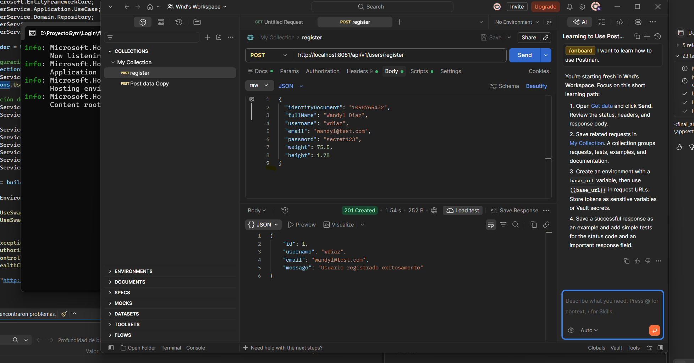
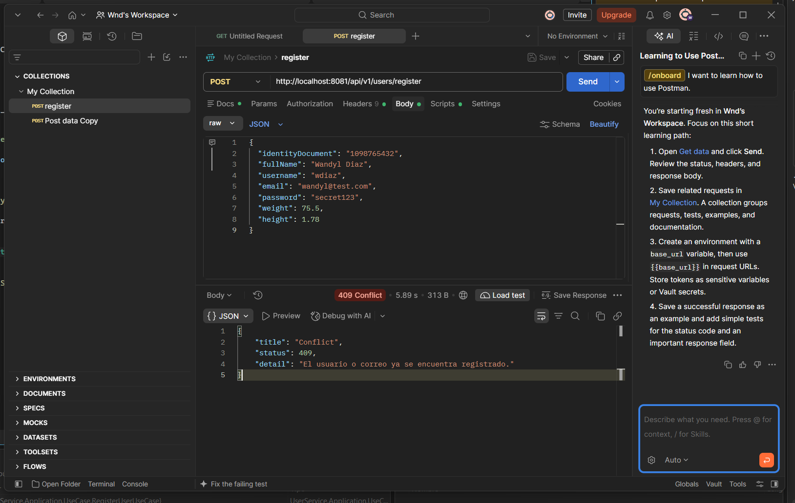
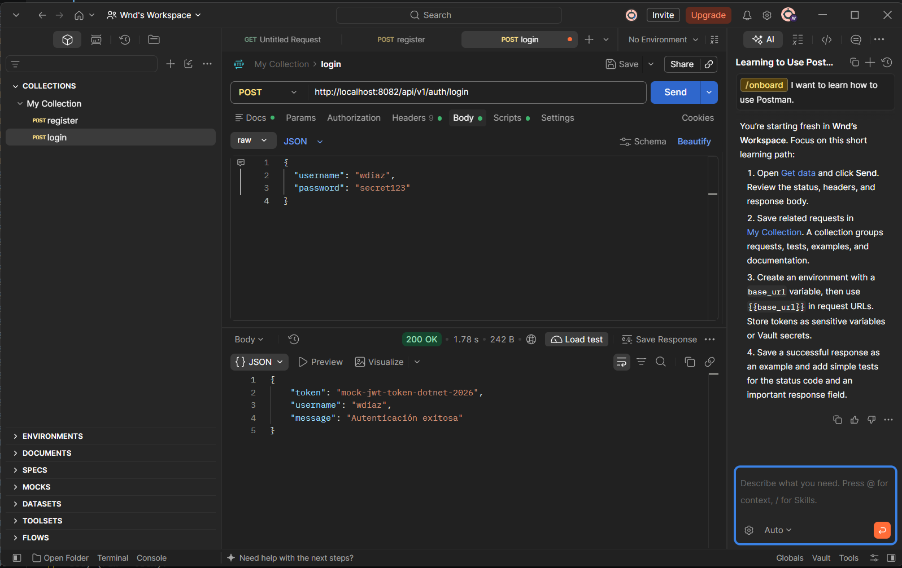
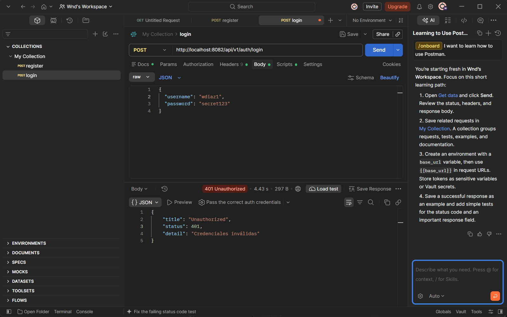
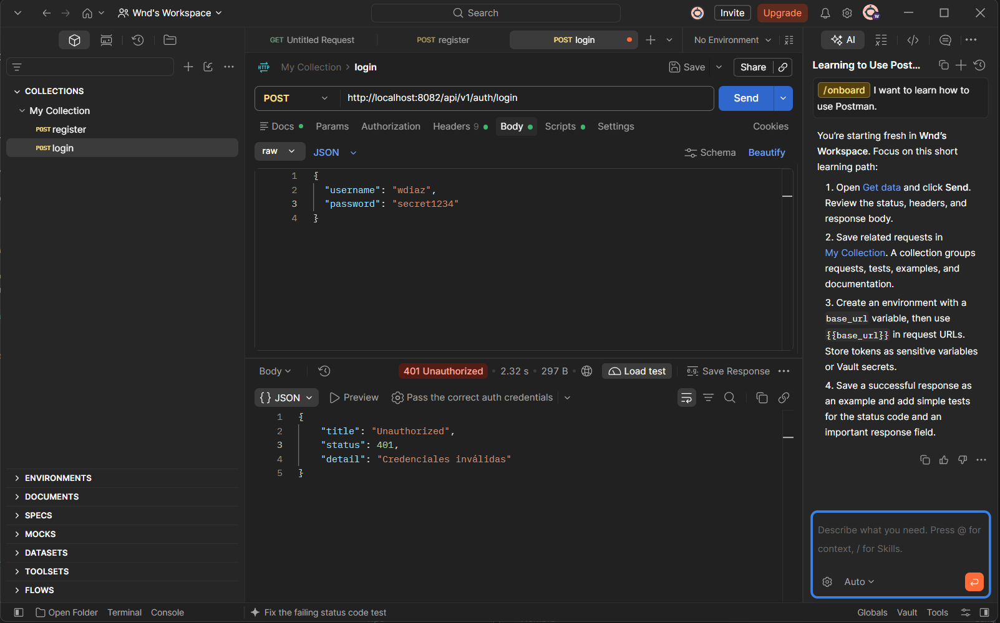

# Fitness Microservices (.NET / C#)

Sistema distribuido compuesto por dos microservicios independientes desarrollados en **C# con ASP.NET Core (.NET 8/9)** bajo **Clean Architecture**, conectados a una base de datos **MySQL** con optimizaciones de rendimiento, resiliencia, manejo global de errores y pruebas unitarias automatizadas.

---

## Arquitectura General del Sistema

La solución `FitnessMicroservices` implementa **Clean Architecture (Arquitectura Limpia)**, asegurando que la lógica de negocio sea completamente independiente de los frameworks web y motores de base de datos mediante el principio de inversión de dependencias.
```text
FitnessMicroservices/
├── UserService/                         # Microservicio de Registro de Usuarios (Puerto 8081)
│   ├── Domain/                          # Capa de Dominio (Núcleo de negocio puro)
│   │   ├── Model/User.cs                # Entidad de dominio User
│   │   ├── Exception/UserAlreadyExistsException.cs
│   │   └── Repository/IUserRepository.cs # Puerto de salida (Interfaz)
│   ├── Application/                     # Capa de Aplicación (Casos de uso)
│   │   └── UseCase/RegisterUserUseCase.cs
│   ├── Infrastructure/                  # Capa de Infraestructura (Detalles técnicos)
│   │   └── Persistence/
│   │       ├── UserEntity.cs            # Entidad mapeada a tabla MySQL
│   │       ├── UserDbContext.cs         # Contexto de EF Core
│   │       └── UserRepositoryAdapter.cs # Adaptador que implementa IUserRepository
│   ├── Presentation/                    # Capa de Presentación (API REST)
│   │   ├── Controllers/UserController.cs
│   │   ├── DTOs/UserRegisterRequest.cs
│   │   ├── DTOs/UserRegisterResponse.cs
│   │   └── Middlewares/GlobalExceptionHandler.cs
│   ├── Program.cs                       # Configuración de DI, Middlewares y Swagger
│   └── appsettings.json                 # Cadena de conexión MySQL con Pooling
│
├── AuthService/                         # Microservicio de Autenticación / Login (Puerto 8082)
│   ├── Domain/
│   │   ├── Model/AuthUser.cs
│   │   ├── Exception/InvalidCredentialsException.cs
│   │   └── Repository/IAuthRepository.cs
│   ├── Application/
│   │   └── UseCase/LoginUseCase.cs
│   ├── Infrastructure/
│   │   └── Persistence/
│   │       ├── AuthUserEntity.cs
│   │       ├── AuthDbContext.cs
│   │       └── AuthRepositoryAdapter.cs
│   ├── Presentation/
│   │   ├── Controllers/AuthController.cs
│   │   ├── DTOs/LoginRequest.cs
│   │   ├── DTOs/LoginResponse.cs
│   │   └── Middlewares/GlobalExceptionHandler.cs
│   ├── Program.cs
│   └── appsettings.json
│
├── UserService.Tests/                   # Proyecto de Pruebas Unitarias (xUnit + Moq)
│   └── RegisterUserUseCaseTests.cs
│
└── AuthService.Tests/                   # Proyecto de Pruebas Unitarias (xUnit + Moq)
    └── LoginUseCaseTests.cs


2. Detalle Completo de lo Implementado

A. Patrones de Arquitectura y Diseño
    •	Clean Architecture (4 Capas):
        o	Domain: Contiene únicamente modelos puros (User, AuthUser), excepciones de negocio (UserAlreadyExistsException, InvalidCredentialsException) y contratos/interfaces (IUserRepository, IAuthRepository). No tiene dependencias externas.
        o	Application: Contiene los casos de uso (RegisterUserUseCase, LoginUseCase) que orquestan las reglas de negocio utilizando únicamente las interfaces del dominio.
        o	Infrastructure: Implementa los puertos del dominio mediante adaptadores (UserRepositoryAdapter, AuthRepositoryAdapter) usando Entity Framework Core y el proveedor Pomelo.EntityFrameworkCore.MySql.
        o	Presentation: Expone los endpoints HTTP REST mediante controladores (UserController, AuthController), valida entradas con DataAnnotations en los DTOs y gestiona errores globalmente.
    •	Inyección de Dependencias Explícita (DI): Registrada en Program.cs mediante el contenedor nativo de .NET (builder.Services.AddScoped<...>()), vinculando interfaces de repositorio con sus adaptadores y registrando los casos de uso.
B. Rendimiento y Asincronía (Async/Await)
    •	Procesamiento No Bloqueante: Todos los controladores, casos de uso y operaciones de base de datos son completamente asíncronos (async Task<...>).
    •	Propagación de CancellationToken: Todos los endpoints reciben un CancellationToken desde la petición HTTP y lo propagan hasta las consultas de EF Core (SaveChangesAsync(cancellationToken), FirstOrDefaultAsync(cancellationToken)), liberando recursos inmediatamente si el cliente cancela la solicitud.
C. Base de Datos MySQL y Seguridad
    •	Connection Pooling: Configurado en appsettings.json (Pooling=true;MinimumPoolSize=5;MaximumPoolSize=10;) para reutilizar conexiones abiertas y reducir la latencia.
    •	Consultas Optimizadas y Seguras:
        o	Uso de .AsNoTracking() en consultas de lectura para evitar sobrecarga de seguimiento de cambios en memoria.
        o	Proyección explícita con .Select(...) para recuperar únicamente las columnas necesarias (Id, Username, Email, PasswordHash).
        o	Consultas parametrizadas nativas de EF Core para prevenir ataques de inyección SQL.
    •	Idempotencia e Integridad: Restricciones UNIQUE a nivel de base de datos (uk_identity, uk_username, uk_email) e índices (idx_users_username, idx_users_email) para acelerar las búsquedas y evitar duplicados en condiciones de carrera.
D. Manejo Global de Excepciones y Observabilidad
    •	GlobalExceptionHandler (IExceptionHandler): Middleware centralizado que captura excepciones no controladas y excepciones de dominio, transformándolas en respuestas JSON estandarizadas según el estándar RFC 7807 (ProblemDetails):
        o	UserAlreadyExistsException $\rightarrow$ 409 Conflict
        o	InvalidCredentialsException $\rightarrow$ 401 Unauthorized
        o	Cualquier otro error inesperado $\rightarrow$ 500 Internal Server Error
    •	Validación Automática de DTOs: Atributos [Required], [EmailAddress], [MinLength] y [Range] en UserRegisterRequest y LoginRequest, devolviendo automáticamente 400 Bad Request si los datos son inválidos.
    •	Health Checks: Endpoints /health configurados mediante app.MapHealthChecks("/health") en ambos servicios para verificar el estado de salud del proceso.
    •	Documentación Interactiva (Swagger/OpenAPI): Configurada en ambiente de desarrollo (/swagger) para probar y documentar los contratos de la API.
E. Cobertura de Pruebas Unitarias (xUnit + Moq)
    •	UserService.Tests (RegisterUserUseCaseTests.cs):
        1.	ExecuteAsync_NewUser_ReturnsSavedUser: Verifica el flujo exitoso de registro y la asignación de ID.
        2.	ExecuteAsync_ExistingUser_ThrowsUserAlreadyExistsException: Verifica que se bloquee el registro cuando el usuario o correo ya existen, asegurando que nunca se llame a SaveAsync.
    •	AuthService.Tests (LoginUseCaseTests.cs):
        1.	AuthenticateAsync_ValidCredentials_ReturnsLoginResponse: Verifica la generación de respuesta y token ante credenciales correctas.
        2.	AuthenticateAsync_UserNotFound_ThrowsInvalidCredentialsException: Valida el rechazo cuando el usuario no existe.
        3.	AuthenticateAsync_WrongPassword_ThrowsInvalidCredentialsException: Valida el rechazo cuando la contraseña no coincide.
3. Requisitos Previos
    •	Visual Studio 2022 (v17.8 o superior) con la carga de trabajo Desarrollo de ASP.NET y web.
    •	SDK de .NET 8.0 o superior.
    •	MySQL Server 8.0+ en ejecución en localhost:3306.
    •	Postman (o cURL / Swagger UI).
4. Paso 1: Configuración de la Base de Datos
Ejecuta el siguiente script SQL en tu instancia local de MySQL
Nota: Verifica que el usuario y contraseña en appsettings.json (Uid=root;Pwd=root;) coincidan con tu configuración local de MySQL.
```
5. Paso 2: Compilar la Solución en Visual Studio
    1.	Abre FitnessMicroservices.sln en Visual Studio.
    2.	En el Explorador de soluciones, haz clic derecho sobre la solución $\rightarrow$ Restaurar paquetes NuGet.
    3.	Compila toda la solución con Ctrl + Shift + B (o menú Compilar $\rightarrow$ Compilar solución).
    4.	Confirma en la ventana de salida que los 4 proyectos compilan sin errores.
6. Paso 3: Ejecutar las Pruebas Unitarias
    1.	Abre el Explorador de pruebas presionando Ctrl + E, T (o menú Prueba $\rightarrow$ Explorador de pruebas).
    2.	Haz clic en Ejecutar todas las pruebas (icono de doble triángulo verde).
    3.	Verifica que los 5 tests unitarios pasen en verde.
(Opcional desde terminal en la raíz de la solución):
dotnet test

7. Paso 4: Ejecutar Ambos Microservicios
    1.	En el Explorador de soluciones, haz clic derecho sobre la solución FitnessMicroservices $\rightarrow$ Propiedades.
    2.	En Propiedades comunes $\rightarrow$ Proyecto de inicio, selecciona Proyectos de inicio múltiples.
    3.	Establece la acción Iniciar para UserService y AuthService.
    4.	Presiona F5 (o Ctrl + F5). Se levantarán ambos servicios en sus respectivos puertos:
        o	UserService: http://localhost:8081 (Swagger: http://localhost:8081/swagger)
        o	AuthService: http://localhost:8082 (Swagger: http://localhost:8082/swagger)

8. Paso 5: Probar los Endpoints con Postman
A. Registrar Usuario (UserService)
    •	Método: POST
    •	URL: http://localhost:8081/api/v1/users/register
    •	Headers: Content-Type: application/json
    •	Body (raw - JSON):
{
  "identityDocument": "1098765432",
  "fullName": "Wandyl Diaz",
  "username": "wdiaz",
  "email": "wandyl@test.com",
  "password": "secret123",
  "weight": 75.5,
  "height": 1.78
}



Prueba de error (409 Conflict): Envía nuevamente el mismo JSON; el GlobalExceptionHandler devolverá un error 409 indicando que el usuario o correo ya está registrado.



B. Iniciar Sesión (AuthService)
    •	Método: POST
    •	URL: http://localhost:8082/api/v1/auth/login
    •	Headers: Content-Type: application/json
    •	Body (raw - JSON):
{
"username": "wdiaz",
"password": "secret123"
}


    •	Prueba de error (401 Unauthorized): Envía una contraseña incorrecta o un usuario inexistente para verificar la respuesta controlada del manejador global de excepciones.



C. Verificar Salud de los Servicios (Health Checks)
    •	UserService: GET http://localhost:8081/health $\rightarrow$ 200 OK (Healthy)
    •	AuthService: GET http://localhost:8082/health $\rightarrow$ 200 OK (Healthy)
